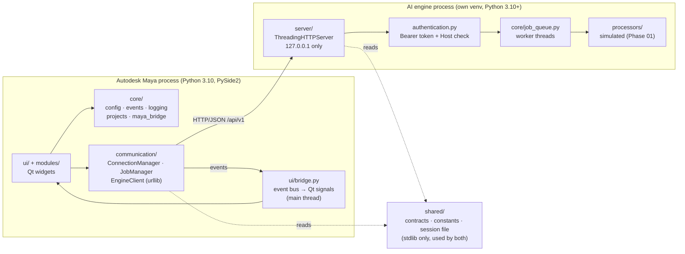
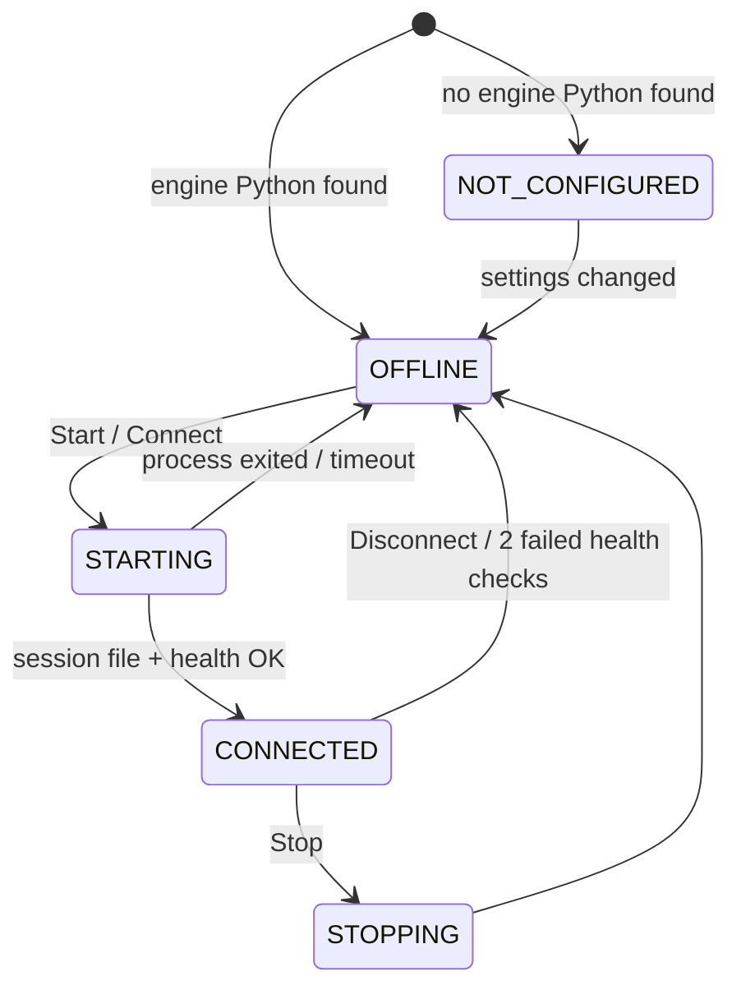

# Architecture

Maya AI Production Toolkit is split into three independent layers that only
talk to each other through explicit contracts.

## Layers

### A. Maya plugin (`maya_plugin/`)

| Package | Responsibility | Depends on |
| --- | --- | --- |
| `core/` | Config (`config_manager`), event bus (`event_manager`), structured logging (`logger`), environment detection (`environment`), toolkit projects (`project_service`), the **only** Maya-scene access point (`maya_bridge`), composition root (`app_manager`). | `shared` (no Qt) |
| `communication/` | `EngineClient` (blocking HTTP), `ConnectionManager` (start/stop/restart/connect/disconnect/health, state machine, health monitor), `JobManager` (submit/poll/pause/resume/cancel), `contracts` (re-export of `shared.contracts`). | `core`, `shared` (no Qt, no Maya) |
| `ui/` | `qt.py` binding shim, theme, main widget, top bar, sidebar, right/bottom panels, dialogs, dock host (`workspace.py`). | `core`, `communication` |
| `modules/` | One package per feature area, discovered through `modules/registry.py` and built lazily. | `ui`, `core` |
| `launcher.py`, `plugin_entry.py` | Shelf entry point and Maya plug-in command (`mayaAIToolkit`). | everything |

Imports only flow downward. `core/` and `communication/` never import Qt or
Maya, so they are fully tested outside Maya.

### B. AI engine (`ai_engine/`)

An independent Python process started with **its own interpreter**
(`.venv_engine`). Standard library only in Phase 01.

* `main.py` – CLI entry, config, logging, token, signal handling.
* `core/engine_manager.py` – lifecycle: bind → write session file → serve →
  shutdown (cancel jobs, remove session file). Optional parent-PID watchdog.
* `core/job_queue.py` – fixed pool of worker threads, per-job locks,
  pause/resume/cancel through events, bounded queue and history.
* `core/task_manager.py` – `job_type → processor` registry.
* `core/gpu_manager.py` – GPU/CUDA detection (torch if already installed,
  else `nvidia-smi`). Never initialises CUDA in Phase 01.
* `processors/` – `BaseProcessor` + `SimulatedProcessor`. Future processors
  plug in here without touching the server.
* `server/` – framework-free router, request pipeline, auth.

### C. Communication layer

* Transport: HTTP/1.1 + JSON on `127.0.0.1` only (bind host validated in config,
  CLI and server constructor). The client bypasses system proxies.
* Versioned API: every route lives under `/api/v1`.
* Envelope: `{"ok": true, "data": …}` or
  `{"ok": false, "error": {"code", "message", "details"}}`.
* Contracts are dataclasses in `shared/contracts` with validating
  `from_dict()`; language-neutral JSON Schemas are in `shared/schemas` for
  future Nuke / 3DEqualizer clients.

| Method | Path | Result |
| --- | --- | --- |
| GET | `/api/v1/health` | `HealthInfo`: status, versions, Python, GPU/CUDA, active/queued jobs, job types |
| GET | `/api/v1/job-types` | available processors |
| GET | `/api/v1/jobs` | all known jobs |
| POST | `/api/v1/jobs` | submit `JobRequest` → `202` + `JobStatus` |
| GET | `/api/v1/jobs/{job_id}` | `JobStatus` (state, progress 0–1, message, result, error) |
| POST | `/api/v1/jobs/{job_id}/cancel` | request cancellation → `202` |
| POST | `/api/v1/jobs/{job_id}/pause` · `/resume` | pause / resume a running job |
| POST | `/api/v1/shutdown` | graceful engine shutdown |

Error codes: `unauthorized` (401), `forbidden_host` (403), `not_found` (404),
`method_not_allowed` (405), `invalid_state` (409), `payload_too_large` (413),
`invalid_json` (400), `validation_error` / `unknown_job_type` (422),
`queue_full` (429), `shutting_down` (503), `internal_error` (500, no internals leaked).

## Security model

* **Loopback only.** The engine refuses any bind address other than
  `127.0.0.1`; `Host` headers other than `127.0.0.1`/`localhost` are rejected
  (DNS-rebinding protection). On Windows the socket uses `SO_EXCLUSIVEADDRUSE`.
* **Session token.** Maya generates a 256-bit token per engine launch and passes
  it via the `MAIT_ENGINE_TOKEN` environment variable (never the command line).
  Every request needs `Authorization: Bearer <token>`; comparison is constant-time.
* **Session file.** The engine publishes `pid/host/port/token` in
  `<user dir>/runtime/engine_session.json` (owner-only permissions where the OS
  supports it, per-user profile folder on Windows) so Maya can attach to an
  engine started by `start_engine.bat`. It is removed on clean shutdown.
* Bodies are capped (1 MB), JSON is strict (no NaN/Infinity), and internal
  exceptions are logged but never returned to the client.

## Threading model (Maya side)

* Every engine operation is queued on a background executor and returns a
  `Future` immediately – **Maya's main thread never waits on the network.**
* `ConnectionManager` serialises connection operations on one worker thread; a
  separate daemon thread performs periodic health checks.
* `JobManager` uses a small executor for commands and one monitor thread that
  polls active jobs.
* Results are published on the event bus from worker threads. `UiBridge`
  re-emits them as Qt signals; because the bridge lives on the GUI thread, Qt
  queues delivery and slots run on Maya's main thread.
* Any future scene change must go through `core/maya_bridge.run_scene_operation`,
  which marshals to the main thread (`maya.utils.executeInMainThreadWithResult`)
  and wraps the work in a single undo chunk.

## Scene safety

The following never touch the Maya scene: plug-in load, shelf click / UI open,
engine start/stop/connect, health checks, project browsing, settings, job
submission, simulated processing, toolkit *Save* (writes toolkit files only).
The only Maya commands the plugin issues in Phase 01 are UI commands
(`workspaceControl`, `deleteUI`, `warning`) and query-only commands for the
read-only *Maya Studio → Scene Information* panel. This is asserted by the
mock-Maya tests (`tests/mock_maya`), which record every `maya.cmds` call.

## Engine lifecycle

UI colours: GREEN = connected, YELLOW = starting/stopping, RED = offline,
GRAY = not configured.

If Maya started the engine, it is stopped when Maya exits (`atexit`) and, as a
backstop, the engine's parent-PID watchdog shuts it down if Maya disappears
(e.g. crash). An engine started manually keeps running until stopped.

## Compatibility strategy

* **Maya versions.** All Qt access goes through `maya_plugin/ui/qt.py`
  (PySide2 for Maya 2022–2024, PySide6 for Maya 2025+). Code targets Python
  3.10 syntax. Docking uses `MayaQWidgetDockableMixin`/`workspaceControl`,
  available since Maya 2017. The module file is version-agnostic.
* **Engine Python.** Any CPython ≥ 3.10 in its own venv. Maya's interpreters
  (`maya`, `mayapy`, `mayabatch`) are explicitly rejected, and Maya's
  `PYTHONHOME`/`PYTHONPATH` are scrubbed from the engine's environment.
* **GPU.** Detected at runtime; absence of a GPU is reported, not an error.

## Extending (later phases)

1. Add a processor in `ai_engine/processors/` (subclass `BaseProcessor`, set
   `job_type`, implement `validate_params`/`run` using `ctx.report` and
   `ctx.checkpoint`) and register it in `task_manager.build_default_task_manager`.
2. Add a contract for its params/results in `shared/contracts` if they are structured.
3. Call it from a module via `app.jobs.submit(JobRequest(...))`; results arrive
   as `JOB_UPDATED` events.
4. Apply results to the scene only on an explicit user action through
   `maya_bridge.run_scene_operation` (main thread, one undo step).
