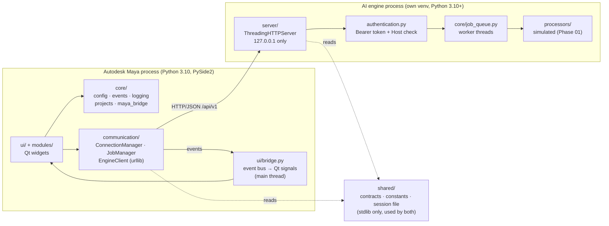
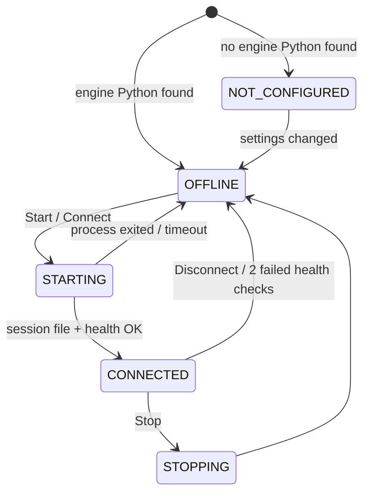

# Architecture

Maya AI Production Toolkit is split into three independent layers that only
talk to each other through explicit contracts.



## Layers

### A. Maya plugin (`maya_plugin/`)

| Package | Responsibility | Depends on |
| --- | --- | --- |
| `core/` | Config (`config_manager`), event bus (`event_manager`), structured logging (`logger`), environment detection (`environment`), toolkit projects (`project_service`), the **only** Maya-scene access point (`maya_bridge`), composition root (`app_manager`). | `shared` (no Qt) |
| `communication/` | `EngineClient` (blocking HTTP), `ConnectionManager` (start/stop/restart/connect/disconnect/health, state machine, health monitor), `JobManager` (submit/poll/pause/resume/cancel), `contracts` (re-export of `shared.contracts`). | `core`, `shared` (no Qt, no Maya) |
| `ui/` | `qt.py` binding shim, theme, main widget, top bar, sidebar, right/bottom panels, dialogs, dock host (`workspace.py`). | `core`, `communication` |
| `modules/` | One package per feature area, discovered through `modules/registry.py` and built lazily. | `ui`, `core` |
| `launcher.py`, `plugin_entry.py` | Shelf entry point and Maya plug-in command (`mayaAIToolkit`). | everything |

Imports only flow downward. `core/` and `communication/` never import Qt or
Maya, so they are fully tested outside Maya.

### B. AI engine (`ai_engine/`)

An independent Python process started with **its own interpreter**
(`.venv_engine`). The server and job system use only the standard library;
Phase 02 adds numpy + OpenCV (core) and, optionally, PyTorch + SAM 2.

* `main.py` – CLI entry, config, logging, token, signal handling.
* `core/engine_manager.py` – lifecycle: bind → write session file → serve →
  shutdown (cancel jobs, remove session file). Optional parent-PID watchdog.
* `core/job_queue.py` – fixed pool of worker threads, per-job locks,
  pause/resume/cancel through events, bounded queue and history.
* `core/task_manager.py` – `job_type → processor` registry.
* `core/gpu_manager.py` – GPU/CUDA detection (torch if already installed,
  else `nvidia-smi`). Never initialises CUDA in Phase 01.
* `processors/` – `BaseProcessor` + `SimulatedProcessor`. Future processors
  plug in here without touching the server.
* `server/` – framework-free router, request pipeline, auth.
* `models/model_manager.py` – model catalog (`config/model_catalog.json`) and
  the local model store (Phase 02, see below).
* `media/frame_source.py` – image sequences and video files read as RGB8.
* `segmentation/` – prompts, matte refinement and the segmentation backends.

### C. Communication layer

* Transport: HTTP/1.1 + JSON on `127.0.0.1` only (bind host validated in config,
  CLI and server constructor). The client bypasses system proxies.
* Versioned API: every route lives under `/api/v1`.
* Envelope: `{"ok": true, "data": …}` or
  `{"ok": false, "error": {"code", "message", "details"}}`.
* Contracts are dataclasses in `shared/contracts` with validating
  `from_dict()`; language-neutral JSON Schemas are in `shared/schemas` for
  future Nuke / 3DEqualizer clients.

| Method | Path | Result |
| --- | --- | --- |
| GET | `/api/v1/health` | `HealthInfo`: status, versions, Python, GPU/CUDA, active/queued jobs, job types |
| GET | `/api/v1/job-types` | available processors |
| GET | `/api/v1/jobs` | all known jobs |
| POST | `/api/v1/jobs` | submit `JobRequest` → `202` + `JobStatus` |
| GET | `/api/v1/jobs/{job_id}` | `JobStatus` (state, progress 0–1, message, result, error) |
| POST | `/api/v1/jobs/{job_id}/cancel` | request cancellation → `202` |
| POST | `/api/v1/jobs/{job_id}/pause` · `/resume` | pause / resume a running job |
| POST | `/api/v1/shutdown` | graceful engine shutdown |

Error codes: `unauthorized` (401), `forbidden_host` (403), `not_found` (404),
`method_not_allowed` (405), `invalid_state` (409), `payload_too_large` (413),
`invalid_json` (400), `validation_error` / `unknown_job_type` (422),
`queue_full` (429), `shutting_down` (503), `internal_error` (500, no internals leaked).

## Security model

* **Loopback only.** The engine refuses any bind address other than
  `127.0.0.1`; `Host` headers other than `127.0.0.1`/`localhost` are rejected
  (DNS-rebinding protection). On Windows the socket uses `SO_EXCLUSIVEADDRUSE`.
* **Session token.** Maya generates a 256-bit token per engine launch and passes
  it via the `MAIT_ENGINE_TOKEN` environment variable (never the command line).
  Every request needs `Authorization: Bearer <token>`; comparison is constant-time.
* **Session file.** The engine publishes `pid/host/port/token` in
  `<user dir>/runtime/engine_session.json` (owner-only permissions where the OS
  supports it, per-user profile folder on Windows) so Maya can attach to an
  engine started by `start_engine.bat`. It is removed on clean shutdown.
* Bodies are capped (1 MB), JSON is strict (no NaN/Infinity), and internal
  exceptions are logged but never returned to the client.

## Threading model (Maya side)

* Every engine operation is queued on a background executor and returns a
  `Future` immediately – **Maya's main thread never waits on the network.**
* `ConnectionManager` serialises connection operations on one worker thread; a
  separate daemon thread performs periodic health checks.
* `JobManager` uses a small executor for commands and one monitor thread that
  polls active jobs.
* Results are published on the event bus from worker threads. `UiBridge`
  re-emits them as Qt signals; because the bridge lives on the GUI thread, Qt
  queues delivery and slots run on Maya's main thread.
* Any future scene change must go through `core/maya_bridge.run_scene_operation`,
  which marshals to the main thread (`maya.utils.executeInMainThreadWithResult`)
  and wraps the work in a single undo chunk.

## Scene safety

The following never touch the Maya scene: plug-in load, shelf click / UI open,
engine start/stop/connect, health checks, project browsing, settings, job
submission, simulated processing, toolkit *Save* (writes toolkit files only).
The only Maya commands the plugin issues in Phase 01 are UI commands
(`workspaceControl`, `deleteUI`, `warning`) and query-only commands for the
read-only *Maya Studio → Scene Information* panel. This is asserted by the
mock-Maya tests (`tests/mock_maya`), which record every `maya.cmds` call.

## Engine lifecycle



UI colours: GREEN = connected, YELLOW = starting/stopping, RED = offline,
GRAY = not configured.

If Maya started the engine, it is stopped when Maya exits (`atexit`) and, as a
backstop, the engine's parent-PID watchdog shuts it down if Maya disappears
(e.g. crash). An engine started manually keeps running until stopped.

## Compatibility strategy

* **Maya versions.** All Qt access goes through `maya_plugin/ui/qt.py`
  (PySide2 for Maya 2022–2024, PySide6 for Maya 2025+). Code targets Python
  3.10 syntax. Docking uses `MayaQWidgetDockableMixin`/`workspaceControl`,
  available since Maya 2017. The module file is version-agnostic.
* **Engine Python.** Any CPython ≥ 3.10 in its own venv. Maya's interpreters
  (`maya`, `mayapy`, `mayabatch`) are explicitly rejected, and Maya's
  `PYTHONHOME`/`PYTHONPATH` are scrubbed from the engine's environment.
* **GPU.** Detected at runtime; absence of a GPU is reported, not an error.

## AI Roto (Phase 02)

```
Maya: Roto Studio panel                       Engine process
 Load Plate      --job media_proxies-->  open_source() -> JPEG proxies in <project>/cache/roto_proxies/<plate>_<hash>/
 click / box     (prompts kept in Maya, in source pixels)
 Segment Frame   --job segment_frame-->  BackendCache.get(model) -> segment() -> refine -> preview PNG
 Track Mask      --job roto_track----->  track() forward/backward -> <name>.####.png + <name>.roto.json
 viewer          <-- reads the JPEG/PNG files written by the engine (no pixels over HTTP)
AI Studio: Model Manager  --GET/DELETE /models, job model_install-->  ModelManager (download, verify, remove)
```

* **Model store.** `<user dir>/models/<model_id>/` holds the weights and an
  `installed.json` marker written *last*. Downloads stream to `<file>.part`,
  are size-checked and SHA-256 checked when the catalog publishes a hash, and
  are renamed only after the checks pass, so a cancelled or failed install never
  looks installed. Weights are downloaded only when the artist clicks
  **Install**; catalog URLs must be `https`. Removing a model asks the artist first.
* **Backends** (`segmentation/backends.py`) implement `segment(image, prompts)`
  and `track(read_frame, frames, prompt_frame, prompts, sink, checkpoint)`:
  * `ClassicalBackend` – OpenCV GrabCut seeded from the prompts; tracking warps
    the previous mask with backward Farneback optical flow and re-runs GrabCut
    in a band around the edge. CPU only, no weights, always available.
  * `Sam2Backend` – SAM 2.1 (`sam2==1.1.0`): `SAM2ImagePredictor` for single
    frames, `build_sam2_video_predictor` + `propagate_in_video` for tracking
    (frames are staged as JPEGs in a temp folder, which the predictor requires).
    CUDA with bfloat16 autocast when available, CPU otherwise (slow).
  * `BackendCache` keeps one model loaded and serialises GPU inference with a lock.
* **Jobs.** `model_install`, `media_proxies`, `segment_frame`, `roto_track`.
  Paths in requests must be absolute. Matte files that already exist are never
  overwritten unless the request says `overwrite: true`; the Maya UI asks before
  sending that. A cancelled track stops between frames and writes no manifest.
* **Outputs.** 8-bit single-channel PNG mattes at source resolution
  (`<name>.####.png`) and a JSON manifest with the source, model, prompts,
  refinement settings and per-frame coverage/bbox. Nothing is put into the Maya
  scene in Phase 02; bringing mattes into Maya (image planes, shaders) will be an
  explicit, undoable command in a later phase.
* **Coordinates.** Prompts are stored in source pixels. The viewer maps widget
  positions through the fitted image rectangle, so proxy size never changes prompt
  positions.

## Roto guided by Maya tracking (Phase 03)

The toolkit does **not** track cameras or objects. The artist tracks the shot in Maya, and Roto
Studio uses that tracking to steer the AI mask.

```
Maya scene (query only)                   Maya plugin (pure Python)                 Engine
 tracked camera  --getAttr(time=f)-->  maya_guides.build_guides():          roto_track(guides=...)
 locators / geo  --getAttr / xform-->   project into plate pixels per frame  -> backend.track(..., guides)
                                         (include points, exclude points,       SAM 2: extra prompts on those frames
                                          box around projected vertices)       classical: re-anchor / restart per frame
```

* **Reading (`maya_bridge.read_guide_scene`).** For each plate frame (+ an optional Maya frame
  offset) it reads the camera's `worldMatrix[0]` and `focalLength` with `getAttr(..., time=f)`,
  the camera's film aperture / fit / offset / lens squeeze once, each guide object's
  `worldMatrix[0]` per frame and, for meshes, up to 400 object-space vertices once
  (`xform(query=True)`). Only query commands are used, so the current time, the selection and
  the scene stay untouched (asserted by `tests/mock_maya/test_roto_guides_mock.py`).
* **Projection (`modules/roto_studio/maya_guides.py`).** Maya's camera model: camera looks down
  -Z, image-plane mm = focal * x / -z minus film offset, then the film fit (fill / horizontal /
  vertical / overscan) against the plate aspect maps mm to pixels. Not modelled: pre/post scale,
  film roll, pan/zoom, lens distortion and deformation of skinned meshes (only the transform's
  animation moves the sampled vertices).
* **Guides.** Include locators become include points, exclude locators exclude points, include
  meshes a box around their projected vertices, exclude meshes an exclude point at their projected
  centre. Off-screen points are dropped; frames with nothing of the subject on screen get no guide.
* **Engine (`roto_track`).** New optional params `guides` (`{"<frame>": {"points", "box"}}`),
  `guide_interval` (use every N-th guide, counted from the prompt frame) and `guide_source`
  (a label stored in the manifest). Without manual `prompts`, the guide on the prompt frame is the
  starting prompt. SAM 2 adds the guides as extra conditioning prompts on their frames of the same
  object; the classical backend constrains GrabCut with the guide (outside the padded box is
  background, guide points are hard foreground/background) and restarts from the guide when the
  propagated mask has left it. Every guided frame gets `guide_points_inside`, `guide_box_iou` and a
  `drift` flag in the manifest; the result lists `drift_frames` for the artist to check.

## Rotomation (Phase 04)

Two engine jobs, both cancellable with progress:

* **`pose_track`** (`ai_engine/processors/pose_processors.py`). Params: `source`, `first_frame`,
  `model_id` (2D), optional `body3d_model_id`, `detector_model_id`, `subject` {frame, box},
  `matte_manifest`, `start`/`end`, `output_dir`, `name`, `overwrite`. Runs from the seed frame
  forwards, then backwards. The person box per frame comes from the matte, else the artist box,
  else the detector (best IoU with the previous box), else the previous frame's joints. Writes
  `<name>.pose.json`: per frame `bbox`, `box_source`, `kp2d` (17 joints, x/y/confidence) and
  `kp3d` (camera-space metres, when a 3D model ran).
* **`roto_fit`**. Params: `pose_file`, `fit_input` (written by Maya: camera per plate frame and
  the rig's joint world positions on a reference frame, see `roto_requests.build_fit_input`),
  `options` (`FitOptions`, validated), range, output. Writes `<name>.rotofit.json`: per frame
  joint world positions `p`, reprojection error `err` and foot `contact`, plus `ground_height`.

Body skeleton (`ai_engine/pose/skeleton.py`): 17 joints (pelvis, hips, knees, ankles, toes, neck,
head, shoulders, elbows, wrists) mapped from Halpe26 (RTMPose), COCO17 and MediaPipe33.
Backends (`ai_engine/pose/backends.py`): RTMPose and YOLOX through rtmlib / ONNX Runtime (CUDA,
falling back to CPU), MediaPipe Pose Landmarker (CPU, 2D + world landmarks). Model zips are
extracted by the Model Manager (`ModelFile.extract`), with download mirrors (`ModelFile.mirrors`).

**Fit** (`ai_engine/pose/fit.py`, numpy + scipy `least_squares`, soft-L1 loss). The body is a
rigid pelvis block, a rigid chest block and limb directions with the rig's own bone lengths.
Residuals per frame: confidence-weighted reprojection through the Maya camera model (same model as
Phase 03), agreement with the 3D model's bone directions, staying in front of the camera, and unit
limb directions. Frames are solved in order, each warm-started from the previous one, with a
restart from the 3D prior's limbs (and a facing flip on cold starts) to escape knee flips. A global
pass over all frames (sparse Jacobian) adds acceleration smoothing, foot contact locking (contacts
detected on smoothed sole height/speed) and a ground penalty. Up axis y or z follows the scene.

**Maya side** (`maya_plugin/modules/body_tracking/`): `rig_mapping` (auto-map joints by name
tokens, rig presets), `retarget` (driver frames from joint positions; control offset
`C_ref * inv(M_ref)` recorded on the reference frame, then `C(f) = offset * M(f)`; poles go to a
computed point in the bend plane), `roto_requests` (requests, fit input, bake targets, FK/IK
match, foot lock). `maya_bridge.bake_world_targets` keys temporary locators, constrains the
controls with skipped locked/non-keyable/driven axes, runs `bakeResults` and removes the helpers,
all in one undo chunk.

## Extending (later phases)

1. Add a processor in `ai_engine/processors/` (subclass `BaseProcessor`, set
   `job_type`, implement `validate_params`/`run` using `ctx.report` and
   `ctx.checkpoint`) and register it in `task_manager.build_default_task_manager`.
2. Add a contract for its params/results in `shared/contracts` if they are structured.
3. Call it from a module via `app.jobs.submit(JobRequest(...))`; results arrive
   as `JOB_UPDATED` events.
4. Apply results to the scene only on an explicit user action through
   `maya_bridge.run_scene_operation` (main thread, one undo step).
